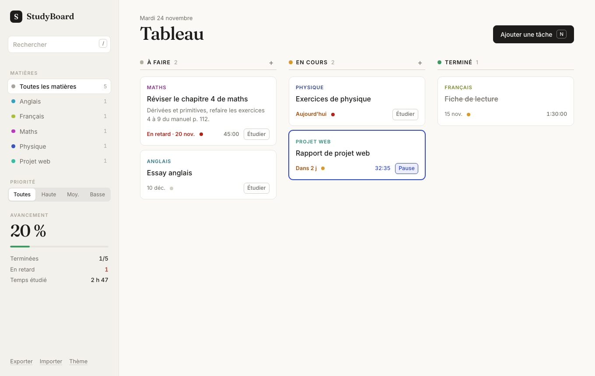

# StudyBoard

Un tableau Kanban pour suivre ses devoirs, projets et révisions. Fait en HTML, CSS et JavaScript, sans framework ni backend.

**Démo :** `https://TON-PSEUDO.github.io/studyboard/`



## Fonctionnalités (v1)

- Tableau en trois colonnes : À faire, En cours, Terminé
- Ajout, modification et suppression de tâches
- Matière, deadline et priorité pour chaque tâche
- Couleur automatique par matière
- Alerte visuelle pour les deadlines proches ou dépassées
- Sauvegarde automatique dans le navigateur (`localStorage`)

## Lancer le projet

```bash
git clone https://github.com/TON-PSEUDO/studyboard.git
cd studyboard
```

Ouvre ensuite `index.html` dans ton navigateur. Aucune installation nécessaire.

## Structure

```
studyboard/
├── index.html
├── css/style.css
└── js/
    ├── storage.js   # lecture et écriture du localStorage
    ├── ui.js        # affichage du tableau et des cartes
    └── app.js       # logique et gestion des événements
```

## Roadmap

- [ ] v2 : drag & drop, filtres par matière et priorité, export/import JSON, mode sombre, statistiques
- [ ] v3 : version React ou Vue, backend Node.js, comptes utilisateurs, projets de groupe

## Licence

MIT
